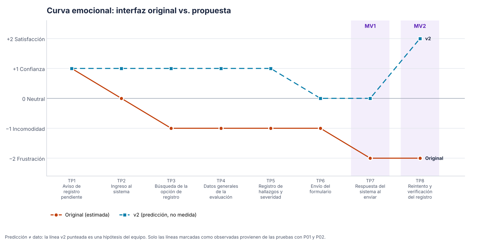

# Iteración v1 → v2 · antes y después

> Fase 4 (60 min) · Responsable: **Integrante 4** (coordina) · C1 Integrante 2 · C2 Integrante 3 · C3 Integrante 4 · Issues #12, #13, #14, #15
> Código: [`../prototipo/v1/`](../prototipo/v1/) → [`../prototipo/v2/`](../prototipo/v2/). Cada cambio está marcado en el código con `[v2-C1]`, `[v2-C2]` o `[v2-C3]`.

## Regla: causalidad hallazgo → cambio

Cada corrección nace de un hallazgo de [`../pruebas/hallazgos.md`](../pruebas/hallazgos.md). Si una hipótesis no se observó con P01/P02, la corrección correspondiente **se reemplaza** por la del hallazgo que sí apareció (o se presenta como mejora preventiva basada en el diagnóstico, diciéndolo así). La columna *Dato medido* solo lleva cifras de las pruebas; la columna *Predicción* es lo que esperamos y no se presenta como resultado.

## Comparación de las 3 correcciones

| | **C1 · Hallazgo sin agregar** | **C2 · Escala de severidad** | **C3 · Error de envío (MV1)** |
|---|---|---|---|
| Hallazgo | H-01 | H-02 | H-03 |
| Heurística | H5, H3 | H6, H2, H10 | H9, H1 |
| Requisito | R3, R4 | R3 | R5 |
| **Antes (v1)** | *Siguiente* descarta en silencio lo escrito y no agregado. | Solo números 0–4; el significado está en otra pantalla (*Ayuda*). | «Error de conexión (NET-01). Inténtalo de nuevo.» No dice si los datos siguen ahí. |
| **Después (v2)** | Diálogo: *Agregar y continuar* / *Seguir editando* / *Descartar*; si falta un dato, muestra el error en el campo. | Número + nombre en cada nivel (Sin problema … Catastrófico), descripción para lectores de pantalla y ayuda desplegable en el mismo formulario. | Título que dice la causa; bloque «Tu evaluación está a salvo» con proyecto, número de hallazgos y hora; *Reintentar envío*, *Revisar* o *Salir y enviar después*; con sesión expirada, «Volver a ingresar y enviar». |
| Captura antes | `evidencias/capturas/v1-05-revision.png` (2 hallazgos tras perder el 3.º) | `v1-03-hallazgos.png` | `v1-07-error-envio.png` |
| Captura después | `v2-04-aviso-hallazgo-sin-agregar.png` | `v2-03-hallazgos.png` | `v2-07-error-envio.png` |
| Commit | `_____` | `_____` | `_____` |

## Medición honesta (completar)

| Indicador | v1 · dato medido (P01 / P02) | v2 · predicción | v2 · dato medido (si se re-prueba) |
|---|---|---|---|
| Hallazgos perdidos sin aviso en T2 (evento `hallazgo_descartado`) | __ / __ | 0 | |
| Preguntas o visitas a *Ayuda* para la severidad en T2 | __ / __ | 0 | |
| Tiempo entre el error de envío y el reintento (s) | __ / __ | menor que en v1 | |
| ¿Creyó que perdió los datos en MV1? | __ / __ | No | |
| Tiempo T2 (s) | __ / __ | similar o menor | |
| Tiempo T3 (s) | __ / __ | similar o menor | |
| Éxito T3 sin ayuda | __ / __ | 2 de 2 | |
| SEQ T3 (1–7) | __ / __ | ≥ 6 | |

Los tiempos de la v2 pueden subir en T2 porque el diálogo de C1 agrega un paso: si ocurre, se reporta y se explica (evita una pérdida de datos a cambio de unos segundos).

## Curva emocional comparada

- **Línea naranja:** interfaz original, *estimada* por el equipo (diagnóstico).
- **Línea azul punteada:** v2, **predicción** del equipo. No es un dato.
- **Línea violeta (aparece al regenerar):** v1 **observada**, promedio de la autocalificación de P01 y P02 por touchpoint.

Para actualizarla: llenar `valor_v1_observado_P01` y `valor_v1_observado_P02` en [`../recorrido-emocional.csv`](../recorrido-emocional.csv) y ejecutar `python herramientas/generar_graficos.py`.

## Conclusión de la iteración (completar con datos)

*Ejemplo de redacción honesta:* «En la v1, __ de 2 participantes perdieron un hallazgo al pulsar *Siguiente* sin agregarlo (evento `hallazgo_descartado`). La v2 intercepta esa acción con un diálogo (C1). No se re-probó la v2 con usuarios, por lo que la mejora es una predicción verificable en la próxima iteración.»
